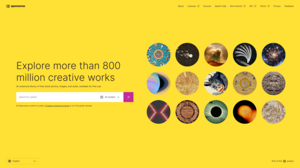

### Hi there 👋
<!--
**obulat/obulat** is a ✨ _special_ ✨ repository because its `README.md` (this file) appears on your GitHub profile.

Here are some ideas to get you started:

- 🔭 I’m currently working on ...
- 🌱 I’m currently learning ...
- 👯 I’m looking to collaborate on ...
- 🤔 I’m looking for help with ...
- 💬 Ask me about ...
- 📫 How to reach me: ...
- 😄 Pronouns: ...
- ⚡ Fun fact: ...
-->

I'm Olga Bulat, full-stack developer working on [Openverse](https://github.com/wordpress/openverse), the search engine for openly-licensed media. 

I am also a member of the Beeware team and an Outreachy alumni (at Creative Commons).

#### Other contributions

I learned from my colleague and friend @sarayourfriend that it's okay to look into the dependency codebases and that you should contribute upstream if you can, so I am also [Nuxter #95](https://nuxters.nuxt.com/obulat)

#### Media Attribution

"<a rel="noopener noreferrer" href="https://commons.wikimedia.org/wiki/Special:Redirect/page/151301355">Openverse screenshot 2024-08-08</a>" by <a rel="noopener noreferrer" href="https://commons.wikimedia.org/w/index.php?title=User:DhruvBhanushali&action=edit&redlink=1">DhruvBhanushali</a> is marked with <a rel="noopener noreferrer" href="https://creativecommons.org/publicdomain/zero/1.0/deed.en/?ref=openverse">CC0 1.0 </a>.

